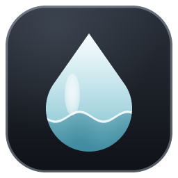

<p align="center"></p>

# Aqua Code

**Your own coding agent. Bring your DeepSeek or Gemini key, start cheap, escalate only when needed.**

Aqua Code is a local, single-file-server coding agent with a liquid-glass interface. It reads and edits files in a workspace folder, runs commands, and shows you exactly what it costs. Made by Saad.

- No dependencies: Python 3.9+ standard library only.
- Runs on `127.0.0.1`. Your key never leaves your machine except to call the provider you chose.

## Install

Pick whichever is easiest. Nothing else to download: Python 3.9 or newer is the only requirement, and the app has no packages.

| | |
| --- | --- |
| **Download button** | [Download the ZIP](https://github.com/saadvvsaadvv344-star/aqua-code/archive/refs/heads/main.zip), unzip it, then double-click `Start Aqua Code.bat` (Windows) or `Start Aqua Code.command` (Mac). Releases also has a ready-made `aqua-code.zip`. |
| **Windows (PowerShell)** | `irm https://raw.githubusercontent.com/saadvvsaadvv344-star/aqua-code/main/install.ps1 \| iex` |
| **macOS (Intel and Apple Silicon) and Linux (Terminal)** | `curl -fsSL https://raw.githubusercontent.com/saadvvsaadvv344-star/aqua-code/main/install.sh \| bash` |
| **git** | `git clone https://github.com/saadvvsaadvv344-star/aqua-code.git && cd aqua-code && python3 aqua_app.py` |

The installers put Aqua Code in `~/AquaCode` (or `%USERPROFILE%\AquaCode`), add a Desktop launcher, and keep your keys, chats and workspace when you run them again to update.

It opens as its own desktop window (Edge, Chrome, Brave or Chromium in app mode: no tabs, no address bar) and stops its server when you close the window. If no Chromium browser is installed (for example only Safari or Firefox), it opens in a normal browser tab instead. You can also run only the server: `python3 server.py`, then open http://127.0.0.1:8765.

### macOS notes (Intel and Apple Silicon)

- Install Python 3.9+ from https://www.python.org/downloads/ (or `brew install python`). The app itself needs nothing else.
- Intel Macs are fully supported in design: there is no native code, and the glass effects default to **Lite**. If it ever feels heavy, open Settings and set **Glass quality** to **Off** for a plain flat look.
- If double-clicking `Start Aqua Code.command` is blocked, run `chmod +x "Start Aqua Code.command"` once, or just run `python3 aqua_app.py` in Terminal.
- I developed and tested this on Windows 11. The macOS and Linux paths are written to the same standard-library code and checked for Python 3.9 compatibility, but I could not run them on a real Mac. Please open an issue if something misbehaves.

### Working level (how hard Aqua works on your PC)

The chat bar (next to Auto / Lite / Pro and the approval mode) has **Working level: Low, Balanced or High**, and Settings has the same choice.

| Level | What it does |
| --- | --- |
| **Low** | Gentle. Plain look (glass off), no animations, no intro, and the Aqua server runs at low priority on a quarter of your CPU cores (4 of 16, never fewer than 2). Anything it starts (commands, dev servers) inherits that. |
| **Balanced** (default) | Soft glass, normal priority, all cores. |
| **High** | Full liquid glass and full speed. |

On Windows you can switch levels at any time. On macOS and Linux a lowered priority cannot be raised again without administrator rights, so going back up from Low needs an app restart there. Heavy jobs such as rendering the explainer video run with their own limits (see `video/README.md`).

### Plain mode (remove the liquid glass)

Settings, **Glass quality**: **Full** (real refraction), **Lite** (soft glass, default) or **Off** (flat panels, no blur, no animation, no effects: fastest). **Water intro animation** can be switched off separately.

## Quick start

1. Start it (see Install).
2. Paste a free API key on the first screen, or press **Try without a key**.
3. Describe what you want built.

Without any key, Aqua uses the one free model that still answers anonymously (LLM7, gpt-oss:20b). It is slow, rate limited, and your prompts are public, so add a free key as soon as you can. You can turn this fallback off in Settings.

## Free API keys

Aqua Code is set up to work on free keys. On first launch it shows a step-by-step guide per provider and an **Open the key page** button.

| Provider | Free? | Notes |
| --- | --- | --- |
| **Gemini** (Google AI Studio) | Yes, free tier, no credit card | Key at https://aistudio.google.com/apikey. Limits apply per project and per model, reset at midnight Pacific, and can change; check the rate-limit page in AI Studio. On the free tier Google may use your prompts to improve its products, so do not send secrets. |
| **DeepSeek** (official API) | No permanent free tier | Pay as you go and very cheap. New accounts sometimes get a one-time trial credit; the amount and conditions vary, so check https://platform.deepseek.com. |
| **OpenRouter** (free models) | Yes, `:free` models, no card | Key at https://openrouter.ai/keys. As of 2026-11-26 OpenRouter lists no free DeepSeek model, so Aqua picks other free models that support tools (it re-checks the list when you connect). Free models are capped (roughly 20 requests/minute and 50/day until you buy $10 of credits). |

What the app does for free keys:

- A provider marked **free-tier** counts its cost as $0 and shows a requests-used ring instead of dollars.
- It respects each model's requests-per-minute and requests-per-day limits (editable per tier).
- When a model hits its limit (including a free model whose quota is 0), it switches to another model that still has quota instead of failing, and tells you in the chat.
- If every model is used up it stops and tells you when the limits reset.

More permanent free tiers from the community lists ([mnfst/awesome-free-llm-apis](https://github.com/mnfst/awesome-free-llm-apis), [amardeeplakshkar/awesome-free-llm-apis](https://github.com/amardeeplakshkar/awesome-free-llm-apis)) are built in as presets, each with its own key: **Groq**, **Cerebras**, **Mistral** and **NVIDIA NIM**. Limits are as those lists state them and may be out of date. When you connect, Aqua asks the provider for its model list and swaps in the closest match for any default model name that no longer exists. In Settings you can also load a provider's model list into the model boxes, and add **any other OpenAI-compatible service** (Kilo, Runcrate, OVHcloud, a local server...) as a custom provider. Check each provider's terms: several free tiers log prompts or use them for training.

Beyond those, `catalog.json` lists 19 more providers (free tiers, small community gateways, and four that need no key at all). It is re-read on every request, so adding a provider there needs no restart. The no-key ones are anonymous: they sit behind an **Enable** button and are only used as backups once you enable them.

**No restart needed for changes.** The launcher reloads `server.py` by itself when it changes (it waits until no task is running) and the page refreshes itself when `index.html` changes, so editing the app never closes your window.

Free-tier numbers in the default config are approximate. Google and OpenRouter change them, so edit them in Settings.

## Preview

The **Preview** button opens a live pane next to the chat (drag its edge to resize):

- Ask the agent for a web page and it appears automatically. The workspace folder is served on its own port (the Aqua port + 1, so previewed pages cannot reach the Aqua API) and reloads whenever the agent edits a file.
- The agent can start a dev server (`start_server`, for example `npm run dev` or `python -m http.server 8000`). It keeps running in the background, opens in the pane, and shows up as a chip you can click or stop.
- Type any address: `3000`, `localhost:5173`, or a website. Desktop, tablet and phone sizes, back, forward, reload, and open-in-browser are built in.
- Some websites refuse to be shown inside other apps. Use the open-in-browser button for those.

## How it saves credit

Every task starts on the **cheapest** model and only moves up when the cheap one struggles:

| Trigger | Result |
| --- | --- |
| 2 failing steps in a row (tool error, syntax error after a write) | next tier |
| 8 steps on one tier without finishing | next tier |
| Rate limit (HTTP 429) or daily request cap on that model | next tier (it has its own quota) |
| The model calls `request_stronger_model` | next tier |
| You press **Escalate now** | next tier |

The full conversation is handed over, so the stronger model continues instead of starting again. The next message resets to the cheap tier unless you enable "stay on the stronger model". You can also pin a tier from the composer.

Default ladders (all editable in Settings, including prices and limits):

- **DeepSeek:** `deepseek-chat` then `deepseek-reasoner`
- **Gemini:** `gemini-2.5-flash-lite`, `gemini-2.5-flash`, `gemini-2.5-pro`

## Limits and credit display

- Spend today against a daily budget, plus a total budget. The agent refuses to call the API once a budget is reached.
- Per-model requests today vs. the daily cap, and requests per minute vs. the per-minute cap. The agent waits for a free per-minute slot instead of failing.
- "Saved $X" compares your real spend with always using the top tier.
- DeepSeek: live account balance. Gemini has no balance API, so use the budget.

Prices and limits in the default config are my best knowledge at the time of writing. Check your provider's pricing page and edit them in Settings.

## What the agent can do

`list_dir`, `read_file`, `write_file`, `edit_file` (exact unique replace), `search` (regex), `run_command`, and `request_stronger_model`. Python and JSON files are syntax-checked after every write, and a failure counts toward escalation.

Approval modes: ask for every change, auto-approve edits but ask for commands (default), or full auto.

## Interface

Liquid-glass UI with dark and light themes, a water intro, per-tier chips, diffs for edits, approval cards, escalation banners and a file viewer. Settings has a **Glass quality** switch:

- **Lite** (default): soft glass, smooth everywhere.
- **Full**: real edge refraction and an animated background. Heavier on the GPU and only works in Chrome/Edge.

## Security notes (please read)

- File tools are confined to the workspace folder. **`run_command` is not sandboxed**: it runs a real shell as your user in that folder. A small denylist blocks obviously destructive commands, but it is not a security boundary. Keep the default "ask for commands" mode unless you trust the task.
- Your API keys are stored in plain text in `data/config.json`. That folder is git-ignored. Do not commit it.
- The server binds to `127.0.0.1` only and has no authentication. Do not expose it to a network.
- The model sees the contents of files it reads. Do not point the workspace at folders with secrets.

## Project layout

```
aqua_app.py   desktop launcher (server + app window)
server.py     HTTP server, agent loop, tools, usage and budget tracking
assets/       logo and icon
index.html    the whole UI (no build step)
data/         config, usage and chat history (git-ignored, created on first run)
workspace/    default folder the agent works in (git-ignored)
```

Environment variables: `AQUA_CODE_PORT` (default 8765), `AQUA_CODE_DATA` (data folder).

## Roadmap ideas

Streaming responses, more providers (any OpenAI-compatible endpoint already works by changing the endpoint in Settings), git integration, per-project workspaces.

## License

MIT. See `LICENSE`.
